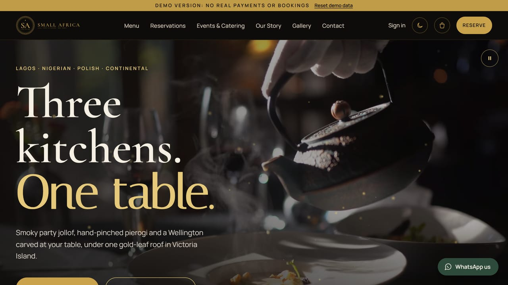
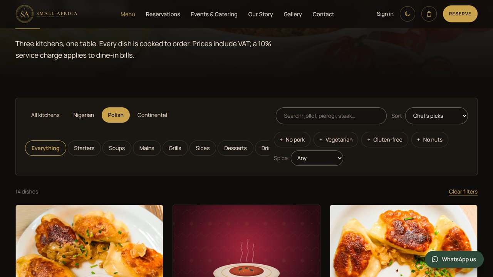
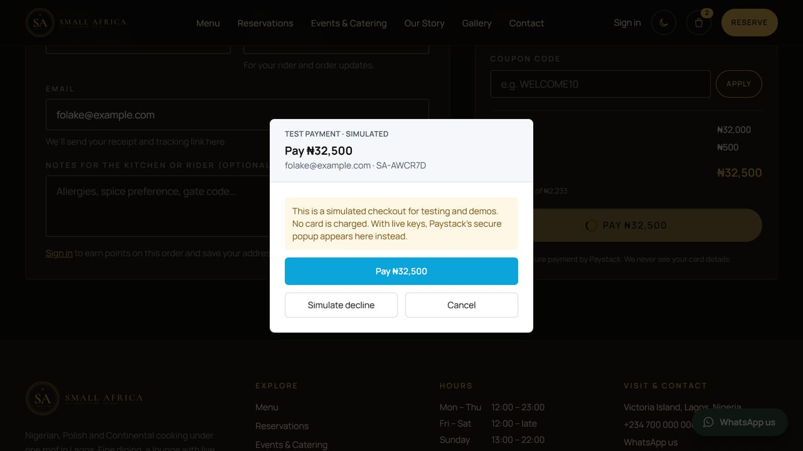
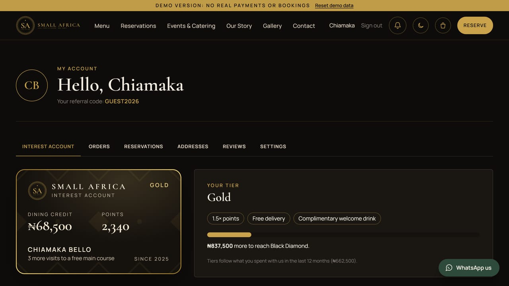
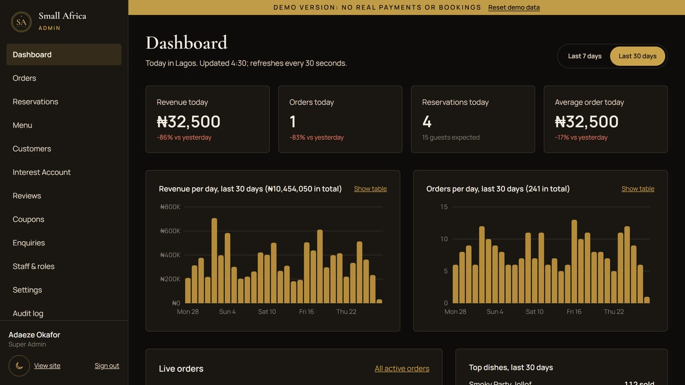
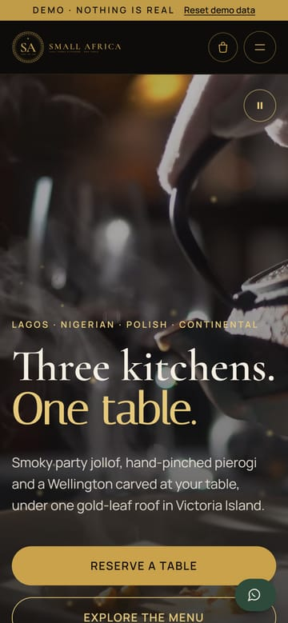
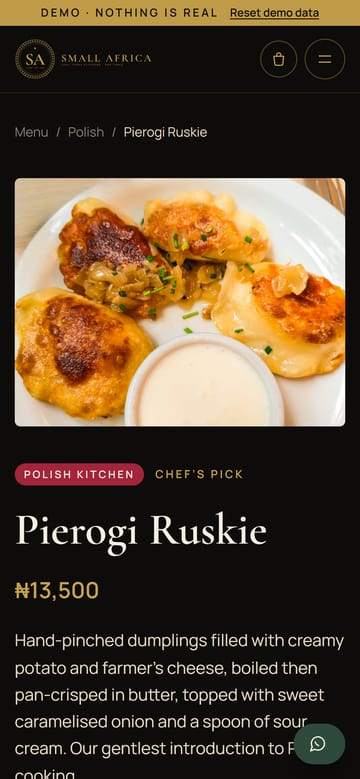

# Small Africa

**Three kitchens. One table.** A fine-dining restaurant and lounge platform for Lagos, serving Nigerian, Polish and Continental cuisine. It covers online ordering, reservations, the *Small Africa Interest Account* loyalty programme, and a full admin panel.

**Live demo:** <https://alokwemsamuel.github.io/small-africa/> — the whole site and admin panel running in your browser on invented data (sign-ins below).



| Menu (Polish kitchen) | Checkout with Paystack (simulated in the demo) |
|---|---|
|  |  |
| **The Interest Account** | **Admin dashboard** |
|  |  |

<p>
  
  
</p>

## Features

**For guests**
- Cinematic video hero, dark and light themes, fast on phones (public pages are pre-built HTML)
- Menu of 54 dishes across three kitchens, filters (kitchen, dietary, *No pork*), a page per dish
- Online ordering: delivery to seven Lagos zones or pickup, order now or schedule, coupons, VAT included
- Paystack payments (card, bank transfer, USSD) verified on the server; live order tracking
- Reservations with live availability by seating area; event and private-dining enquiries
- **The Interest Account:** dining credit with top-up bonuses and 2% monthly interest (capped), points, four tiers, stamp card, streaks, birthday, anniversary and referral rewards, notification centre

**For the team**
- Role-based admin panel (Super Admin, Manager, front desk, kitchen) with dashboard and charts
- Orders and kitchen tickets, reservations and capacity, menu manager with photo uploads
- Customers and dine-in bills, Interest Account and rewards manager, reviews, coupons, enquiries
- Staff and roles, settings, and an audit log of every change

**Under the hood**
- Strict security headers and CSP, CSRF protection, rate limiting, 2FA, append-only ledgers (see [SECURITY.md](docs/SECURITY.md))
- Nigeria Data Protection Act 2023: privacy policy, cookie notice, marketing consent
- 310 automated tests (186 frontend, 124 backend), plus a Playwright check that no page scrolls sideways on phones from 320px to 430px (it runs before every deploy)

## Tech stack

| Layer | Technology |
|---|---|
| Frontend | React 18 with JavaScript (JSX), Vite, Tailwind CSS 4, React Router, TanStack Query, React Hook Form + Zod |
| Backend | PHP 8.1+ (Slim 4), PDO, MySQL 8 / MariaDB 10.4+ |
| Payments | Paystack (test mode in development) |
| Email | PHPMailer over SMTP (`log` driver in development) |
| Testing | PHPUnit, Vitest + Testing Library |

## Project structure

The code is JavaScript (`.js`, `.jsx`) and PHP: no TypeScript. Project rules for future work are in [CLAUDE.md](CLAUDE.md).

```
CLAUDE.md          project rules (languages, structure, checks before each commit)
frontend/          the website and admin panel (React + Vite)
  index.html       page shell; public/theme-init.js applies the theme before first paint
  jsconfig.json    lets VS Code understand the @/ import alias (@/ = src/)
  vite.config.js   dev proxy to the PHP API, demo build for GitHub Pages, test setup
  public/          favicons, brand files, hero video and posters, photos, robots.txt, sitemap
  scripts/         sitemap generator, and prerender.mjs (pre-builds the public pages as HTML)
  src/
    main.jsx       entry point (starts the in-browser API in the demo build; attaches to pre-built pages)
    entry-server.jsx  renders public pages to HTML for scripts/prerender.mjs
    app/           App.jsx, router.jsx, layouts/ (site and sign-in layouts), theme/ (dark/light/system)
    components/    shared React components
      ui/          buttons, fields, badges, photos, toasts… (no business logic)
      layout/      header, footer, navigation, theme switcher, cookie notice, demo ribbon, 404 page
      motion/      page transitions, scroll reveals, smooth scrolling
      menu/        DishCard and its add-to-order action (used by the menu and home page)
      rewards/     MembershipCard (used by the account and the admin)
      payment/     the simulated Paystack popup
    hooks/         shared data hooks: useAuth, useMenu, useCart, useAccount, useInterestAccount, usePaymentPopup
    lib/           API client, response shapes (apiSchemas), formatters (₦, dates), Lagos time,
                   checkout API, Paystack loader, photos, roles, sign-in form rules, demo/ (in-browser API)
    features/      one folder per area; each has pages/ and its own pieces and tests
      home/  menu/  cart-checkout/  orders/  reservations/  account/  rewards/
      auth/  events/  content/ (about, gallery, contact, FAQ, legal, style guide)
      admin/       admin panel: AdminApp, pages/, charts, shared admin UI and API
    styles/        index.css (Tailwind setup) and theme.css (colour tokens for both themes)
    test/          test setup and helpers
backend/           PHP API (Slim 4)
  public/          index.php and .htaccess: the only web-facing folder
  src/             App.php (routes), Http/ (controllers, middleware, errors), Services/,
                   Repositories/, Loyalty/ (Interest Account), Payments/, Security/, Mail/,
                   Media/, Audit/, Support/, Seeds/
  migrations/      database schema, in order
  seeds/           seed data (the menu)
  bin/             command-line tools: migrate, seed, generate-key, loyalty (daily/interest/reconcile), export-demo
  storage/         uploads, logs, sessions (outside the web root, git-ignored)
  tests/           PHPUnit unit and integration tests
design/            logo, brand guide, social templates, menu card, video sources (git-ignored), tools/
docs/              deployment, demo mode, security, security checklist, go-live checklist,
                   screenshots/ (used in this README),
                   presentation guide, marketing plan
presentation/      client pitch deck (.pptx and .pdf) and the walkthrough video (offline backup)
.github/workflows/ builds the demo and publishes it to GitHub Pages on every push to main
```

**Rules:** a feature never imports another feature's files. Anything used by two or more features goes in `components/`, `hooks/` or `lib/`. Components are `PascalCase.jsx`, hooks `useSomething.js`, everything else `camelCase.js`, folders `kebab-case`. Import shared code with the `@/` alias (`@/lib/format`); use `./` only inside the same folder.

### Adding a page or feature

1. Create `frontend/src/features/<name>/pages/<Name>Page.jsx` (a new folder for a new area).
2. Put its API calls in `features/<name>/api.js`, or in `hooks/` / `lib/` if another feature will use them too. Validate forms with Zod.
3. Add the route in `src/app/router.jsx` (lazy-loaded like the others) and, if needed, a link in `components/layout/nav.js` or `features/admin/nav.js`.
4. Add a test next to it (`<name>.test.jsx`). Use `mockApi` and `renderRoutes` from `@/test/utils`.
5. Run `npm run lint`, `npm test` and `npm run build` before committing.

## Local setup (Windows + XAMPP)

Prerequisites: XAMPP (Apache + MariaDB, PHP 8.1+), Composer, Node.js 20+.

1. Clone into `C:\xampp\htdocs\SmallAfrica` and start Apache and MySQL in the XAMPP control panel.
2. **Database**: create the databases and a dedicated user (in the XAMPP shell or phpMyAdmin):
   ```sql
   CREATE DATABASE small_africa CHARACTER SET utf8mb4 COLLATE utf8mb4_unicode_ci;
   CREATE DATABASE small_africa_test CHARACTER SET utf8mb4 COLLATE utf8mb4_unicode_ci;
   CREATE USER 'small_africa'@'localhost' IDENTIFIED BY 'choose-a-strong-password';
   GRANT ALL PRIVILEGES ON small_africa.* TO 'small_africa'@'localhost';
   GRANT ALL PRIVILEGES ON small_africa_test.* TO 'small_africa'@'localhost';
   ```
3. **Backend**:
   ```bash
   cd backend
   composer install
   cp .env.example .env          # set DB_PASSWORD
   php bin/generate-key.php      # paste the APP_KEY line into .env
   composer fresh                # migrate + seed (incl. demo members, orders and Interest Account history; never use --demo in production)
   composer test                 # 124 tests
   ```
   Check it works: <http://localhost/SmallAfrica/backend/public/api/health>
4. **Frontend**:
   ```bash
   cd frontend
   npm install
   npm run dev                   # http://localhost:5173 (proxies /api to XAMPP)
   npm test                      # Vitest
   npm run lint                  # ESLint
   npm run build:demo && npm run test:e2e   # Playwright: no page may be wider than a 320–430px phone (dark and light; first time: npx playwright install chromium)
   npm run build                 # production build + pre-built public pages (npm run build:demo for the GitHub Pages demo)
   ```
   Optional asset rebuilds (design/tools): `npm run photos` (Unsplash photos → AVIF/WebP), `npm run hero` (hero poster + loop video; needs the dev server and ffmpeg), `npm run brand`, `npm run logo`.

5. **Scheduled jobs** (Interest Account): in production a daily cron job runs `php bin/loyalty.php daily` at about 00:10 Lagos time (see [DEPLOYMENT.md](docs/DEPLOYMENT.md#6-the-daily-interest-account-job-cron)). Locally, run it by hand when you want to; every step is safe to repeat.
   - Also: `php bin/loyalty.php interest 2026-09` (pay one month) and `php bin/loyalty.php reconcile` (check every balance against its ledger).

In development, emails are written to `backend/storage/mail/` as `.html` files rather than sent.

## Demo accounts (seeded)

| Role | Email | Password |
|---|---|---|
| Super Admin | admin@smallafrica.demo | SmallAfrica@Admin2026 |
| Manager | manager@smallafrica.demo | SmallAfrica@Manager2026 |
| Customer | guest@smallafrica.demo | SmallAfrica@Guest2026 |
| Staff (kitchen) | kitchen@smallafrica.demo | SmallAfrica@Kitchen2026 |
| Staff (front desk) | frontdesk@smallafrica.demo | SmallAfrica@Desk2026 |

They work on the live demo too. These exist for demos and testing only: remove or change them before going live.

## Deployment

- **GitHub Pages demo:** automatic on every push to `main` ([workflow](.github/workflows/deploy-demo.yml)).
- **Production (PHP host):** step by step in [docs/DEPLOYMENT.md](docs/DEPLOYMENT.md), with environment variables, Paystack live keys, the daily cron job, email and backups.
- Before taking real orders: [docs/GO-LIVE-CHECKLIST.md](docs/GO-LIVE-CHECKLIST.md).

## Build progress

- [x] **Phase 1 — Brand & design**: logo (SA Monogram Crest) and exports, brand guide PDF, Instagram templates, A4 menu card, Figma tokens and components
- [x] **Phase 2 — Foundation**: schema (40 tables) + seeds, secure auth API, frontend shell, auth pages, living style guide (`/style-guide`)
- [x] **Phase 3 — Public site**: cinematic video hero (Pexels footage, poster for reduced motion and Data Saver), menu with filters (incl. No pork), dish detail, basket, about, gallery, events, contact, FAQ, privacy (NDPA 2023), terms; Dark/Light/System appearance
- [x] **Phase 4 — Reservations & ordering**: checkout (delivery/pickup, scheduling, coupons), Paystack + simulated payments, order tracking, reservations with live availability, account tabs
- [x] **Phase 5 — Interest Account**: dining wallet with Paystack top-ups and bonus, monthly interest job, points, tiers, stamp card, streaks, birthday/anniversary/referral rewards, win-back and favourite-kitchen offers, notification centre, append-only ledgers
- [x] **Phase 6 — Admin panel**: role-based panel (Super Admin, Manager, front desk, kitchen) with dashboard and charts, orders and kitchen tickets, reservations and capacity, menu manager with secure photo uploads, customers and dine-in bills, Interest Account & Rewards manager, reviews, coupons, enquiries, staff, settings and audit log
- [x] **Phase 7 — Demo mode, testing & hardening**: the whole site and admin running in the browser for GitHub Pages (busy, always-current demo data; simulated Paystack; reset), deep-link support on Pages, faster first load (animation libraries off the critical path), cross-device and WebKit checks, Lighthouse, security checklist, and an offline walkthrough video in `presentation/`
- [x] **Phase 8 — Deploy & deliver**: public pages pre-built as HTML (mobile Lighthouse 90+), GitHub Actions deploy of the demo to GitHub Pages, deployment guide, presentation guide, marketing plan and the client pitch deck

See [docs/DEPLOYMENT.md](docs/DEPLOYMENT.md) to deploy, [docs/DEMO.md](docs/DEMO.md) for the demo build, [docs/PRESENTATION_GUIDE.md](docs/PRESENTATION_GUIDE.md) and [docs/MARKETING_PLAN.md](docs/MARKETING_PLAN.md) for the client presentation and launch, [docs/SECURITY.md](docs/SECURITY.md) and [docs/SECURITY-CHECKLIST.md](docs/SECURITY-CHECKLIST.md) for the security model and [CREDITS.md](CREDITS.md) for asset licences.
